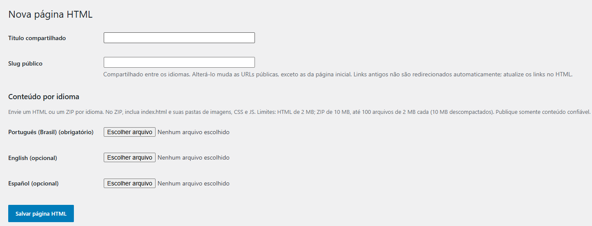

# HTMLPress

Publique páginas HTML completas no WordPress, com suporte a versões em português, inglês e espanhol. Envie um arquivo HTML ou um pacote ZIP com imagens, CSS e JavaScript diretamente pelo painel.



## Recursos

- Publicação de HTML completo sem alterar o editor padrão do WordPress.
- Versão em português obrigatória e versões opcionais em inglês e espanhol.
- Envio de HTML individual ou ZIP com os arquivos da página.
- Slug compartilhado entre os idiomas e URLs específicas para cada versão.
- Metadados de URL canônica e idiomas alternativos para SEO.
- Possibilidade de usar uma página HTMLPress como página inicial.
- Edição, lixeira e restauração pelo painel do WordPress.

> O plugin não traduz o conteúdo automaticamente. Os arquivos de cada idioma e os links visíveis entre eles devem ser preparados por você.

## Requisitos

- WordPress 6.5 ou superior.
- PHP 8.1 ou superior, com a extensão `finfo`.
- Extensão PHP `zip` (`ZipArchive`) para enviar arquivos ZIP.
- Links permanentes amigáveis ativados.

Para gerenciar páginas, o usuário precisa das permissões `manage_options`, `unfiltered_html`, `edit_pages`, `publish_pages` e `upload_files`. Em multisite, a permissão `unfiltered_html` é restrita a superadministradores; a constante `DISALLOW_UNFILTERED_HTML` bloqueia o gerenciamento.

## Instalação

1. No WordPress, acesse **Plugins → Adicionar plugin → Enviar plugin**.
2. Envie o ZIP de instalação do HTMLPress e ative o plugin.
3. Em **Configurações → Links permanentes**, ative uma estrutura de links amigável.

## Como usar

1. Acesse **Páginas → Adicionar página HTML**.
2. Informe o título e o slug público compartilhados entre os idiomas.
3. Envie o arquivo HTML ou ZIP em português. Se desejar, envie também as versões em inglês e espanhol.
4. Clique em **Salvar página HTML**. As versões enviadas são publicadas imediatamente.

Cada arquivo HTML deve estar em UTF-8 e conter um documento completo, com as tags `<html>`, `<head>` e `<body>` e seus respectivos fechamentos.

### URLs e idiomas

| Idioma | Página comum | Página inicial |
| --- | --- | --- |
| Português (obrigatório) | `/slug/` | `/` |
| Inglês (opcional) | `/en/slug/` | `/en/` |
| Espanhol (opcional) | `/es/slug/` | `/es/` |

Para configurar a página inicial, acesse **Configurações → Leitura**, escolha uma página inicial estática e selecione a versão em português.

### Editar uma página

Em **Páginas**, edite qualquer versão do grupo. Deixe o campo de arquivo vazio para manter o conteúdo daquele idioma; um novo envio substitui seu HTML e seus arquivos associados. É possível adicionar traduções posteriormente.

O slug pode ser alterado e afeta as URLs de todos os idiomas, exceto as da página inicial. **Links antigos não são redirecionados automaticamente** após a alteração: atualize os links no seu HTML.

## Preparar um ZIP

Inclua um `index.html` e os arquivos necessários, diretamente na raiz do ZIP ou dentro de uma única pasta principal:

```text
index.html
css/
  estilo.css
js/
  site.js
imagens/
  foto.jpg
```

Os caminhos relativos são preservados. URLs absolutas e caminhos iniciados por `/` permanecem inalterados. Arquivos PHP, SVG, links simbólicos, caminhos inseguros e extensões desconhecidas são recusados.

**Limites por idioma:** HTML de até 2 MB; ZIP de até 10 MB, com até 100 arquivos de até 2 MB cada e 10 MB no total descompactado. Os limites de upload e POST do PHP também se aplicam.

## Segurança e armazenamento

**Publique somente conteúdo confiável.** O HTML é servido na mesma origem do site, e seus scripts executam no navegador dos visitantes.

O HTML principal é armazenado em metadados privados e os arquivos dos pacotes ficam em `uploads/htmlpress`, fora da pasta do plugin. Ao desativar o plugin, conteúdo e metadados permanecem, mas as rotas e a renderização personalizadas deixam de funcionar enquanto ele estiver inativo.

Cada idioma pode ser enviado à lixeira, restaurado ou excluído individualmente. Para editar uma tradução que está na lixeira, restaure-a primeiro.
